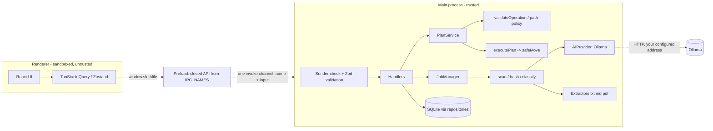

# Architecture

SlothFile is a local-first **modular monolith**. There is no server.

## Processes
- **Main** (`src/main`): startup order is open DB → migrate → reconcile interrupted file operations against the real filesystem → mark stale jobs interrupted → register IPC → create window. The AI provider is never contacted at startup, so a missing Ollama cannot block launch. Shutdown cancels jobs between files, waits for them, checkpoints and closes SQLite.
- **Preload** (`src/preload`): exposes `window.slothfile`, generated from `IPC_NAMES`. It imports only `shared/contracts/names.ts` (no zod: sandboxed preloads can only require `electron`). One justified cast types the generated object.
- **Renderer** (`src/renderer`): custom components, feature pages, hooks. It never sees a filesystem path it can act on.

## IPC contract
`src/shared/contracts`: `names.ts` (zod-free list), `index.ts` (Zod schemas per name, `IpcOutputs`, compile-time exactness checks). Each call: trusted sender (own window, top frame, own origin) → known name (own-property check) → strict schema → handler → `{ok,data}` or sanitized `{ok:false,error}` (no stacks).

## AI provider abstraction
`AIProvider` (`getStatus`, `listModels`, `classifyFile`). `OllamaProvider` uses structured output (`format` = JSON schema), validates with Zod, retries once only for invalid/empty output, maps timeouts/disconnects/cancellation to typed errors, and refuses non-loopback addresses unless the user explicitly allowed remote. Prompts delimit untrusted document text and tell the model to classify, not obey.

## Database
SQLite (`better-sqlite3`), WAL, foreign keys, versioned migrations (`PRAGMA user_version`; refuses newer schemas). Repositories hold all SQL. Extracted text is never stored. Tables: settings, selected_folders, files, classifications, organization_plans, planned_operations, operation_history (the write-ahead journal), jobs.

## Jobs
In-process `JobManager` with a legal-transition table (`queued → running → completed|failed|cancelled|interrupted`), bounded concurrency, one active job per type, throttled progress events, persisted rows. Jobs left running by a dead process become `interrupted` and are **never auto-resumed**. Plan execution is a job too (progress, cancel between files, awaited at shutdown).

## Plans, validation, execution
`PlanService` builds proposals from classifications; destination = `buildDestinationPath(folderRoot, categoryDir, sanitizedName)`. `validateOperation` runs when building, editing, previewing and again right before each move: scope (lexical + realpath), name rules, exclusions, source regular file and unchanged fingerprint, destination absent, parent not a file, duplicate destinations across the plan (case-insensitive). Editing drops approval. Execution only runs operations that are both `approved` and in the caller's confirmed list.

## Filesystem mutation and recovery
`safeMove`: revalidate → `link(source,dest)` (atomic create-if-absent) → verify source unchanged → `unlink(source)`. Fallback (other volume / no hard links): copy to hidden temp with exclusive flag, SHA-256 verify, publish without overwrite, remove source only after verification. A crash between steps leaves two copies, never zero. Journal row `started` is written before the first step. At next launch `reconcileInFlight` inspects disk: nothing moved → mark not started; both present and provably identical → finish; destination only → record completed; anything ambiguous → keep everything and flag for review.

## Undo
Eligible only if: history completed, not already undone, destination still the same file (size, mtime, hash when known), original path free, both paths in scope. Undo is not a backup; it is refused rather than guessed. Only empty folders SlothFile created are removed.
